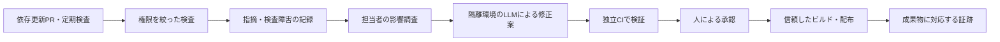

# サプライチェーン・脆弱性対応の設計

## 目的と適用範囲

このリポジトリで検証した運用を企業の複数リポジトリに展開できるようにする。最初はnpm依存とGitHub Actionsを対象にする。コード自体の脆弱性検査、コンテナ・OS依存、組織のID管理やログ保管は追加の導入条件であり、初期実装に含まれたと解釈しない。

NIST SSDFは開発・保護・脆弱性対応の抜けを確認するため、SLSAは成果物の来歴とビルド保護の要件を確認するために使う。規格適合やSLSAレベルの達成宣言は、証拠を別途評価するまで行わない。

## 守るものと脅威

守る対象は、ソース、lockfile、CI定義、依存取得経路、トークン、成果物、配布先、判断履歴である。悪意ある依存の公開、Actionのタグ差し替え、侵害されたメンテナー、外部PR、検査サービスの停止、LLMへの間接的な指示、管理者の検査迂回を考慮する。

`npm ci` のlockfile一致は再解決を防ぐが、依存が安全であることは証明しない。公開後の待機期間は発見の猶予を作るが、未知の悪意や間接依存のすべてを防げない。既知の脆弱性の照合も、未知の悪意の検知を保証しない。

## 処理と信頼境界

外部PR、依存のインストール処理、ビルド、LLMの入力・出力は信頼しない。検査ジョブには原則 `contents: read` だけを与える。Code scanningへのアップロードに限ってOSVジョブへ `security-events: write` を与える。PRのコードを実行する環境へ本番シークレットを渡さない。

特権付き処理が未検証のPRコード・スクリプト・成果物を取り込む構成を避ける。特に `pull_request_target` や `workflow_run` を追加する場合、イベントを変えるだけで安全になるとは扱わない。特権側でPRのコードをcheckoutして実行してはならない。

## 初期段階の実装

`CI gate` はビルド、npm audit、セキュリティ処理のテストがすべて成功した場合のみ成功する。`OSV gate` はイベントに対応するスキャンとレポート生成が成功した場合のみ成功する。依存ジョブの失敗・取消・予期しないスキップを成功として扱わない。マージキュー用の `merge_group` にも対応する。

npm auditはlockfileを直接検査し、検査のために依存スクリプトを実行しない。high以上を失敗とする。OSVはPRでは新規の既知脆弱性を、merge queue・mainへのpush・日次では既存分も検査し、重大度によらず検出時に失敗とする。この違いは意図的で、OSVの差分検査が通っても既存の問題がないとは言えない。

OSVの全体レポートは可視化用であり、PRの合否判定を上書きしない。レポート欠損・不正なJSON・不正な結果構造は障害として失敗させる。`results` に含まれるパッケージ数を検査総数と表示しない。検出数はパッケージとアドバイザリの組で数え、CVEの別名をまたぐ一意件数とは呼ばない。

直接参照するActionと再利用ワークフローは、公式リポジトリのタグと照合した完全なコミットSHAで固定する。ただし再利用先のAction、コンテナタグ、実行時ダウンロード、runnerイメージまで固定したことにはならない。後続の導入審査では参照先内部も棚卸しする。DependabotでSHA更新PRを継続する。

自動マージは初期段階で有効にしない。開発依存もビルド時に実行されるため、developmentやpatchという分類だけで低リスクとは判断しない。主要動作テスト、必須チェック、権限制御の実証後に、対象パッケージ・変更ファイルの許可リストを使って別途設計する。

## GitHub側で必要な設定

このブランチの作成時点では、mainにレビューを要求するrulesetはあるが必須ステータスチェックはない。Dependabot alertsとsecurity updatesも無効だった。既存のsecret scanningとpush protectionは有効である。これは観測時点の状態であり、適用済みという意味ではない。

mainに修正ワークフローを導入し、実際のPRでチェック名を確認してから `CI gate` と `OSV gate` をrulesetの必須チェックに登録する。チェックの提供元はGitHub Actionsへ限定し、mainの直接更新を禁止する。レビュー1件、古い承認の無効化、最後のpush以外の承認を維持する。企業導入時は個人所有から組織所有へ移し、重要ファイルを担当するチームによるレビューと、最小限の緊急迂回権限を設定する。

管理者の常時迂回が現在のrulesetにあるため、通常運用には使わない。企業では緊急権限の所有者、利用理由、利用通知、事後レビューを監査ログと関連付ける。GitHub設定を適用したら、読取りAPIで再取得した結果と負の実験を証拠にする。

Dependabot alerts・security updatesを有効にする。通常更新の待機期間を緊急のセキュリティ更新に適用しない。通知先を実際に受信できる担当者へ設定し、アラート未対応と定期検査の停止を監視する。定期実行は遅延・停止することがあるため、日次cronの存在だけで検出時間を保証しない。

## 対応手順と期限の実験値

担当は実験中はリポジトリ所有者。企業導入時はサービス担当とセキュリティ担当を別の役割として割り当て、不在時の代理も登録する。検出時にアドバイザリ、対象依存と導入経路、対象コミット、本番配布の有無、検出時刻、担当、期限を案件へ記録する。同じ指摘の再検出は既存案件へ追記し、無制限に案件を重複作成しない。

初期の応答目標は、悪用確認済み・侵害疑いを即時エスカレーションし24時間以内に封じ込め方針、criticalを1営業日以内に調査して72時間以内に修正または緩和、highを7日以内、その他を30日以内に判断する。これは実験用の提案値であり、24時間対応体制や企業SLAを保証しない。到達可能性、公開範囲、実際の悪用情報で優先度を上げる。LLMの影響なし判定だけで期限を解除しない。

修正版がない場合も放置せず、機能停止、依存の撤去、アクセス制限などの緩和策と再評価日を記録する。既知の悪意ある依存を実行した疑いがあれば、依存更新だけで完了にせず、環境隔離・実行履歴の調査・資格情報の失効をインシデント対応に接続する。

例外は、指摘ID、対象パッケージとバージョン、対象リポジトリ、理由、補完策、所有者、承認者、失効日時を必須とする。作成者だけで承認しない。期限切れ・不完全な例外は不承認と同じ扱いにする。初期実装は例外による検査回避を提供しない。

## LLM修正の後続実験

最初は担当者が起動する。入力はアドバイザリ、依存経路、関連コード、失敗ログへ絞り、秘密情報と不要な個人情報を除く。外部文書・PRコメント・パッケージ説明中の命令は信頼しない。LLMへ与える指示だけで権限制限したことにしない。

隔離実行には本番アクセスと永続的な書込みトークンを持たせない。ネットワークは承認済みの取得先へ限定し、実行時間・費用・ファイルサイズ・試行回数を制限する。出力は差分、根拠、実行した検証、未確認事項とし、PR作成は別の限定権限の処理が行う。モデルと実行設定、入力コミット、参照した指摘、実行履歴を記録する。

ポリシー、ワークフロー、所有者設定、例外、デプロイ定義は通常のLLM修正の許可範囲から除外する。許可外の差分はモデル外の検証で拒否する。スキャンを消す、テストを弱める、秘密を外部へ送る指示を与えた実験で拒否を確かめる。モデル自身による「安全」の申告は証拠にしない。

## 成果物と企業展開の後続実験

SBOMは依存部品表、provenanceは何を使ってどの工程で成果物を作ったかの来歴である。ソースのコミット、lockfileのハッシュ、ビルドの実行ID、成果物のダイジェストを対応付け、配布側が期待する作成者・リポジトリ・ワークフローと照合する。

現在はVercelのビルド・配布経路の詳細が未検証である。同一成果物を昇格できる方式か、Vercel側のビルド来歴を検証できる方式を調査してから採用する。GitHub側で作った別成果物へ署名しただけで本番を証明しない。ダイジェストが違う成果物を配布しようとした場合に拒否する実験を必須にする。

企業展開では共通ワークフローを専用リポジトリからSHA固定で呼び出し、組織のrulesetで実行を強制する。各リポジトリが自己申告した成功だけに依存しない。共通設定の変更レビュー、ロールバック、段階展開と設定逸脱の検知を用意する。ログは権限を分離した保管先へ転送し、実験は90日を目安に保存、企業は契約・監査要件に応じて保存期間を決める。

## 実験と昇格条件

| 段階 | 実験 | 合格条件 |
| --- | --- | --- |
| 初期CI | 正常な変更 | 必須チェックが実行され成功する |
| 初期CI | 脆弱性を持つ依存を追加 | 実際のPRで失敗し、通常権限でマージできない |
| 初期CI | スキャナー停止・取消・JSON欠損・結果不正 | 成功や0件に変換されず、gateが失敗する |
| 初期CI | Dependabot・外部forkのPR・merge queue | 書込み秘密を渡さず検査でき、必要なチェックが報告される |
| 対応 | 修正PR・修正版なし・再検出 | 案件に紐付き、担当と期限を追跡できる |
| 例外 | 承認なし・期限切れ・対象違い | 検査回避できない |
| LLM | 正常な修正と悪意ある入力 | 修正を独立CIで確認し、権限逸脱をモデル外で拒否する |
| 配布 | 正規成果物と差し替え成果物 | 正規のものだけ配布できる |
| 横展開 | 2つ目のリポジトリで設定を削除 | 組織側の統制が削除を検知・阻止する |

ローカルの合成データによるテスト、GitHubの実PRによる実験、企業での導入審査を別の証拠として記録する。初期CIの合格だけで後続段階を完了にしない。

## 参照資料

- [NIST SSDF](https://csrc.nist.gov/pubs/sp/800/218/final)
- [SLSA](https://slsa.dev/spec/v1.2/)
- [GitHub Actionsの安全な利用](https://docs.github.com/en/actions/reference/security/secure-use)
- [DependabotとActionsの制約](https://docs.github.com/en/code-security/reference/supply-chain-security/dependabot-on-actions)
- [必須チェックとmerge_group](https://docs.github.com/en/pull-requests/how-tos/merge-and-close-pull-requests/troubleshooting-required-status-checks)
- [成果物の証明](https://docs.github.com/en/actions/how-tos/secure-your-work/use-artifact-attestations/use-artifact-attestations)
- [OWASP LLM Prompt Injection Prevention](https://cheatsheetseries.owasp.org/cheatsheets/LLM_Prompt_Injection_Prevention_Cheat_Sheet.html)
